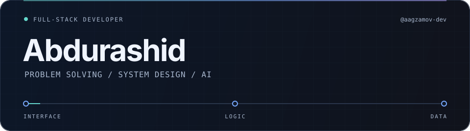

  

<h3 align="center">Understand the problem. Design the system. Build the solution.</h3>

  Laravel, .NET, React &amp; TypeScript at the core. 
  Web and desktop development · Applied AI · LLMs &amp; RAG

  <a href="#about">About</a> &nbsp; / &nbsp;
  <a href="#engineering-focus">Engineering focus</a> &nbsp; / &nbsp;
  <a href="#tech-library">Tech library</a> &nbsp; / &nbsp;
  <a href="#current-work">Current work</a>

---

## About

I'm **Abdurashid**, a **mid-level full-stack developer** focused on **problem solving and system design**. I turn requirements into application logic, APIs, and interfaces, working across web and desktop software.

I also work with **Python, LLMs, and retrieval-augmented generation (RAG)**. I use AI throughout development, with deliberate prompt and context design, while keeping engineering decisions and code quality in my hands.

## Engineering focus

- **Problem solving** — break complex requirements into practical steps, investigate root causes, and choose solutions that fit the problem.
- **System design** — think through application boundaries, data models, APIs, and the trade-offs between simplicity, performance, and maintainability.
- **Applied AI & RAG** — connect LLMs with relevant knowledge and application workflows using Python and retrieval-based approaches.
- **Prompt engineering & AI-assisted development** — structure instructions and context, iterate on outputs, and review AI-generated code against the system's requirements.

## Tech library

### 01 · Core stack

  

**Laravel · .NET · React · TypeScript**  
Backend services, application logic, APIs, and typed frontend interfaces.

### 02 · In active use

  

**C# · Rust · Swift · Python · Tauri**  
Windows desktop development with C#/.NET, native macOS tools with Swift, cross-platform desktop apps with Rust/Tauri, and AI workflows with Python.

### 03 · Data & infrastructure

  

**Apache Kafka · Redis · PostgreSQL · SQLite · Docker**  
Event streaming, caching, relational and local data storage, and containerized development.

Also in my toolkit: **PHP, Next.js, Node.js, React Native, Expo, and SwiftUI**.

## Current work

**Internal government systems**

I work on government systems for document workflows, messaging, and email, including end-to-end encrypted communication. My work brings together application development, system design, and secure communication within internal platforms.

---

  <a href="https://github.com/aagzamov-dev?tab=repositories">Explore my public code ↗</a>

